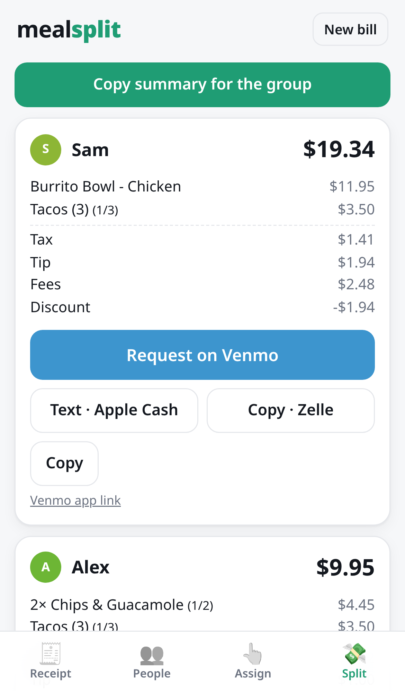

# mealsplit

A tiny static web app for splitting a food bill with friends and requesting payment. No backend, no accounts. Everything (your details, friends, current bill, recent meals) stays in your browser's localStorage.



## What it does

1. **Receipt**: paste receipt text, or scan/upload a photo (OCR runs on your device via [tesseract.js](https://github.com/naptha/tesseract.js). The photo never leaves the phone, and the engine loads only when you pick a photo). It parses items, subtotal, tax, tip, fees and discounts. Every item is editable; tip can be `$` or `%` of the subtotal.
2. **People**: save friends (name, Venmo username, phone/email for Zelle/Apple Cash). You ("me") are never charged.
3. **Assign**: tap an item, then tap who had it. Shared items split evenly.
4. **Split**: per-person breakdown plus:
   - **Request on Venmo**: `https://venmo.com/?txn=charge&audience=private&recipients=USER&amount=X.XX&note=…` (and a `venmo://paycharge` app link as fallback)
   - **Text · Apple Cash**: opens Messages with a prefilled `sms:` message
   - **Copy · Zelle** / **Copy message**: clipboard text (Zelle has no request deep links)
   - **Copy summary for the group**
   - **Save to history**: keeps this meal in the list on the History tab
5. **History**: your last 20 meals (date, place or first item, total, people). Tap one to re-open it read-only, or duplicate it into a new bill. Also home to **Your data**: export, import, clear all.

Tax, tip and discounts are allocated in proportion to each person's item subtotal; fees can instead be split evenly. Cents are allocated with the largest-remainder method, so the shares always add up to exactly the receipt total.

## Develop

Vite + React + TypeScript (strict). Needs Node 20 or newer.

```sh
npm ci            # install the exact locked versions
npm run dev       # dev server at http://localhost:5173
npm run check     # typecheck + lint (Biome) + unit tests with a coverage floor (Vitest); run before pushing
npm run build     # production build into dist/ (any static host works)
npm run preview   # serve dist/ locally, including the service worker
```

On iPhone: open the served page, then Share → Add to Home Screen. The service worker only registers in production builds (`build` + `preview`), so dev reloads are never cached. Service workers need HTTPS (or localhost), so over plain `http://` on your LAN the app works but not offline or installed. [`docs/TRY_ON_IPHONE.md`](docs/TRY_ON_IPHONE.md) has the exact steps to try a build on a phone, including a local HTTPS option with no hosting and no secrets.

Other scripts: `npm run test:e2e` (see below), `npm test`, `npm run test:coverage`, `npm run test:watch`, `npm run typecheck`, `npm run lint`, `npm run format` (Biome auto-fix).

CI (`.github/workflows/ci.yml`) runs typecheck, lint, unit tests, a build and the e2e smoke test on every pull request (and on pushes to `main`). It has read-only permissions, no secrets, and never deploys.

## Test

Vitest covers the pure core and the state and storage layers (reducer actions, history cap, migrations from v1 fixtures in `src/storage/__fixtures__/`, corrupt and future data, the export/import round trip, and save failures against a storage that throws). It also covers: the split math (proportional tax/tip, shared items, penny reconciliation, edge cases), the receipt parser on seven sample receipts (`src/core/__fixtures__/receipts/`, including an `edge-cases.txt` of known probes), the link/message builders, and money formatting. Tests sit next to the code as `*.test.ts`. `npm run test:coverage` enforces thresholds on `src/core` (see `vite.config.ts`).

The parser gives every item a `confidence` (0 to 1) and typed `reasons`. Items below `LOW_CONFIDENCE` get a subtle highlight in the item list until you edit them. The rules for what counts as a fee, a discount, or an item are documented at the top of `src/core/parser.ts`.

### End-to-end smoke test

Playwright drives a production build (`vite preview`, port 4173, started automatically) on an iPhone 14 profile in **WebKit**, plus a Pixel 7 profile in Chromium. It walks Example receipt → friends → assign (with a shared item) → Split (shares add up, Venmo link recipient/amount), checks that a reload keeps state, that the manifest is valid and Chromium finds nothing blocking install, that the service worker registers, that the shell loads offline after a single visit, that a scan works offline once the OCR files have been fetched, and the whole update flow.

```sh
npx playwright install --with-deps webkit chromium   # once; --with-deps needs sudo on Linux
npm run test:e2e
npm run test:e2e -- --project=iphone-webkit          # one browser
npx playwright show-report                           # after a failure
```

`e2e/storage.spec.ts` seeds old v1 localStorage and checks it migrates, then covers history (save, re-open read-only, duplicate, the 20 cap), New bill keeping friends ticked, corrupt and future data, a full-storage notice, tab persistence, and export, import and clear all.

`e2e/flow.spec.ts` covers the step bar and Back/Next, multi-select and "everyone" assignment, undo, the unassigned warnings, edits surviving a re-parse (and a reload), and a 44px tap-target check. `e2e/a11y.spec.ts` runs `@axe-core/playwright` (pinned) on every step in light and dark.

`e2e/payments.spec.ts` covers the "owes nothing" state, the discount cap warning, and the Split-step check against the receipt's own total.

### Payments and manual checks

- Nobody who owes $0 or less gets a Venmo, Apple Cash or Zelle request; their card says so instead. Links are built from cleaned input (Venmo username, phone number, note) and always percent-encoded.
- A discount larger than the item subtotal is capped at the subtotal, with a visible warning. What you typed is kept.
- The check line on the Split step compares against the receipt's parsed total; with no parsed total it says so rather than showing a tick.
- Real-phone checks (Venmo deep links, Messages, Add to Home Screen, offline, dark mode) are in [`docs/IPHONE_CHECKLIST.md`](docs/IPHONE_CHECKLIST.md).

## The flow

One step bar across the top (Receipt → People → Assign → Split) shows where you are and what is done. **Back / Next** sit at the bottom, in thumb reach; History and New bill are in the header, since they are not steps. A bottom tab bar would have repeated the step bar, so there is one control, not two.

- **Assign:** tap an item, then tap who had it. **Select several** lets you tap more items first, so one tap on a person applies to all of them (a person is shown as "mixed" when only some of the items have them). **All** on a row splits that item among everyone; **Split the rest among everyone** and **Everyone shares everything** do it in bulk.
- **Undo:** every assignment change, and re-parsing over existing items, can be undone (a toast, or **↶ Undo**; the last 30 steps). Editing an item or an amount starts a new undo history, so Undo never surprises you. Undo history is in memory only and is never saved.
- **Unassigned items** are flagged on Assign (Next becomes **Split anyway**) and on Split (a clear alert that the shares add up to less than the bill, with a button back to Assign). It warns rather than blocks, because leaving something unassigned can be deliberate.
- **Tax, tip, fees and discount** are plain editable fields. Whatever you type is marked **edited** and is kept if you parse the receipt again (the toast says what was kept). **Let parsing replace it** hands a field back to the parser.
- **Accessibility:** semantic buttons and labelled inputs, `aria-current="step"` on the step bar, focus moves to the step heading when you change step, visible focus rings, 44px minimum tap targets, AA colour contrast in light and dark, iPhone safe-area insets, and `prefers-reduced-motion`. An axe scan runs on every step in both themes (`e2e/a11y.spec.ts`).

## Saved data

All of it lives on your device, in `localStorage`, and only `src/storage/` touches it (a unit test enforces that).

- **What is kept:** your payment details, saved friends (with their handles), the current bill, the last 20 meals, and which step you were on, and which of tax, tip, fees and discount you edited by hand (the undo history is not saved).
- **New bill** saves the current bill to history (empty bills are skipped) and starts a fresh one **with the same friends ticked**: the same people usually eat together, so you only change what is different. Friends are never removed by a new bill.
- **History** keeps one entry per bill (saving again updates it), newest first, capped at 20. Each meal remembers the friends who were there, so it still reads correctly if you delete a friend later.
- **Format:** a versioned envelope `{ "version": 2, "data": { me, people, bill, history, tab } }` under the key `mealsplit`. `src/storage/migrate.ts` has the migrations (v1 to v2 so far) and a deep, safe merge with defaults, so data missing keys never shows "undefined".
- **Upgrading from v1:** the old unversioned `mealsplit.v1` key is read once and migrated. It is left in place as a rollback copy and ignored once the new key exists.
- **Bad data never crashes the app.** If saved data is corrupt, or comes from a newer version of the app, a copy is stored under `mealsplit.backup`, the app starts fresh, and a dismissible notice says so (the copy can be downloaded from History → Your data).
- **If saving fails** (storage full, private mode) a small dismissible notice says changes aren't being kept and suggests exporting.
- **Export / import:** Export downloads `mealsplit-YYYY-MM-DD.json` (`{ app, version, exportedAt, data }`). Import validates and migrates a file (older versions are fine, newer ones are refused), shows what it contains, and asks before replacing anything. **Clear all data** asks first, then wipes every key and resets.

## Layout

```
index.html                  Vite entry
public/                     manifest and home-screen icons (copied as-is)
src/pwa/                    registers the service worker and shows the update prompt; tests for the worker
src/core/                   pure logic, no DOM or storage; fully unit-tested
  money.ts                  integer-cent helpers
  split.ts                  split math (largest-remainder allocation)
  parser.ts                 receipt text → items + totals
  links.ts                  Venmo / sms: links and message text
src/state/                  app state: types, defaults, pure reducer and selectors, history rules, React context
src/storage/                the only code that touches localStorage: migrations, export/import, adapter
src/ocr/                    photo → text (tesseract.js, loaded on demand; plan.ts is the pure, tested part)
build/                      Vite plugins (copy and verify the OCR files; write sw.js), sw.template.js, the no-CDN scan
src/ui/                     React components: one view per tab, plus small shared pieces
src/main.tsx  src/styles.css
e2e/                        Playwright tests (playwright.config.ts at the root)
```

## Offline and install (PWA)

- **Offline after one visit.** The build writes `dist/sw.js` from `build/sw.template.js` with the exact list of hashed files in the build (`build/pwa.ts`, no dependencies). The worker downloads all of them when it installs, so one visit is enough. It never stores an error, a partial or an opaque response, and a failed download fails the install instead of leaving a half shell.
- **Fast, and kept fresh.** The shell is served from the cache first. The browser checks for a new `sw.js` in the background (and whenever the app comes back to the foreground). The new worker waits: a small "Update available. Your bill is saved." bar offers **Reload** or **Later**. Nothing changes under you mid-bill. Cache names carry the build version, and old caches are deleted when the new worker activates.
- **Scanning offline.** The OCR files (about 7 MB, one wasm engine per device) are cached the first time a scan loads them, in their own cache that survives app updates. After one scan online, scanning works offline. They are not precached, so people who never scan never download them.
- **Install details.** The manifest has an `id`, `display: standalone`, separate `any` and `maskable` icons (the maskable one keeps its artwork inside the central 80% circle), an apple-touch-icon, and light and dark `theme-color`. The iOS status bar style is `default` (an opaque bar that iOS themes light or dark, so nothing needs safe-area handling; `black-translucent` would put white text over the light theme). There are no launch ("splash") images: iOS shows a plain screen while the app starts, and a set per device size is a lot of files for little gain. Both are checked on a real phone in [`docs/IPHONE_CHECKLIST.md`](docs/IPHONE_CHECKLIST.md).
- **Regenerate the maskable icon:** `python3 build/make-maskable-icon.py` (needs Pillow).

## Limits

- OCR accuracy depends on the photo; always check items and totals (the app shows whether your total matches the receipt's).
- Apple Cash and Zelle can't be pre-filled as requests. The app gives you ready-to-send text instead.
- Venmo's link format is unofficial/historical; if it stops prefilling, use the app-link fallback or the copied message.

## Receipt scanning (OCR)

Scanning runs [tesseract.js](https://github.com/naptha/tesseract.js) 7.0.0 on the device. Nothing is sent anywhere, and nothing is loaded from a CDN.

- **Lazy.** The library, worker, wasm engine and language data load only when you pick a photo. The main bundle only holds a small dynamic import. They are cached on first use, so a scan works offline after one online scan (see Offline and install above).
- **Same origin.** `/ocr/worker.min.js`, `/ocr/core/*.wasm.js` and `/ocr/lang/eng.traineddata.gz`. tesseract.js picks the fastest engine the browser can run (relaxed SIMD, SIMD, then plain wasm) from `/ocr/core/`.
- **Copied at build time, not committed.** `build/ocrAssets.ts` (a small Vite plugin) copies them out of `node_modules`, so they exist in `dist/` and in the dev server but not in git. Each file is checked against a pinned SHA-256, so a changed dependency fails the build. To upgrade, change the exact versions in `package.json`, build, and update the hashes it reports.
- **Model.** `tessdata_best` English, integer-quantized (2.9 MB). It is the same model tesseract.js uses by default, and it is a better read of faded thermal paper than the "fast" model for a similar size.
- **Photos.** Large photos are shrunk before OCR (long side at most 2200 px), EXIF orientation is applied, and the image is converted to greyscale with the contrast stretched. iOS converts HEIC to JPEG itself when an input says `accept="image/*"`.
- **Guard.** `src/ocr/offline.test.ts` and `e2e/offline.spec.ts` fail if a CDN URL appears in `src/`, `index.html`, `public/` or the build output. `e2e/ocr.spec.ts` runs real OCR on a synthetic receipt and checks that every request stays on this origin.
- **Regenerate the test receipt:** `python3 e2e/fixtures/make-receipt.py` (needs Pillow and DejaVu Sans Mono).

Licenses are in [NOTICE.md](NOTICE.md) and are also served at `/ocr/licenses/`.
